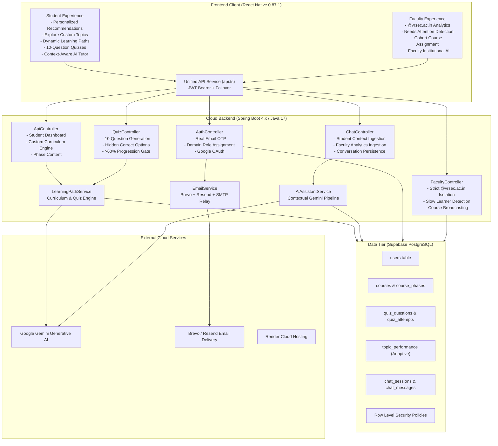
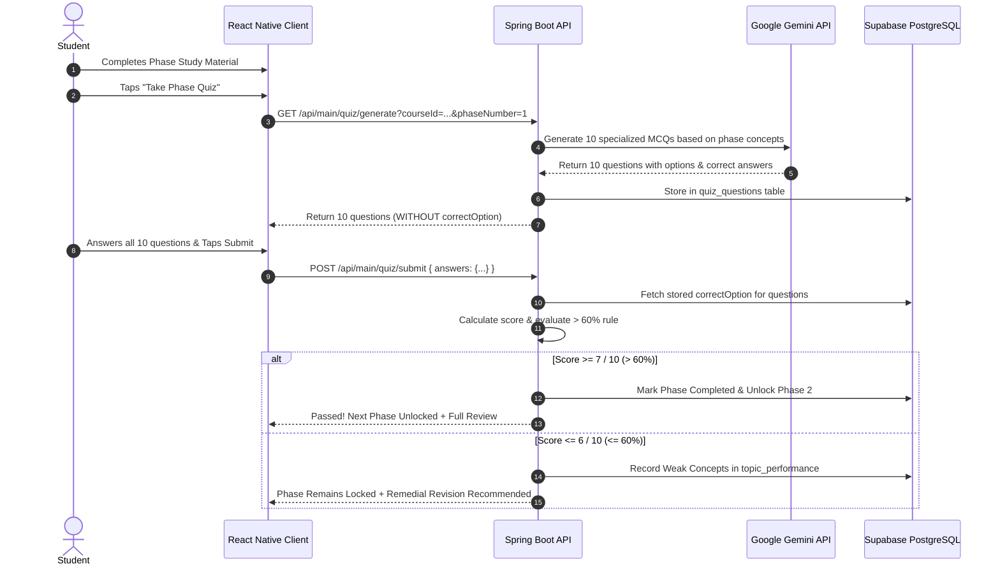

# LearnPath AI — Architecture Documentation

## Overview
**LearnPath AI** is an advanced, production-ready, AI-driven educational platform engineered to generate personalized learning paths for university engineering students, evaluate concept mastery via dynamic 10-question quizzes, and provide real-time departmental intelligence to university faculty.

---

## 1. System Topology & Component Layout

---

## 2. Security Architecture & Role Enforcement

### 2.1 Server-Side Role Assignment
- **Student Registration**: Open to any valid email address (`@vrsec.ac.in` or general).
- **Faculty Registration**: Restricted exclusively to:
  - Any email ending in `@siddhartha.ac.in`
  - `vivekvaranasi99@gmail.com`
- **Zero Client Trust**: Users can NEVER select or alter their role in request payloads. The backend evaluates email domains during verification and signs the calculated role into a cryptographic JWT.

### 2.2 Institutional Analytics Boundary
- Faculty dashboards and reports strictly query accounts ending in `@vrsec.ac.in`.
- Faculty accounts are never counted as students.
- General learners registered with other domains are isolated from faculty departmental tracking.

### 2.3 Assessment Integrity & Hidden Correct Options
- Quiz questions are generated dynamically (10 questions per phase).
- **CRITICAL**: The correct answers (`correctOption`) and concept explanations are stored securely on the backend in `quiz_questions` and are **never** returned to the frontend before quiz submission.
- The client submits only its chosen options (`{ questionId: selectedOption }`).
- Server computes the score and enforces the progression rule:
  - `Score > 6/10 (> 60%)`: Phase marked completed, next phase unlocked, course progress updated.
  - `Score <= 6/10 (<= 60%)`: Next phase remains locked, concept weaknesses recorded in `topic_performance`, remedial materials recommended.

---

## 3. Adaptive Learning Feedback Loop

